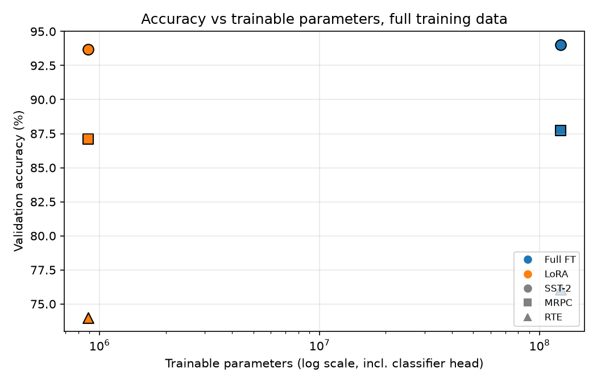
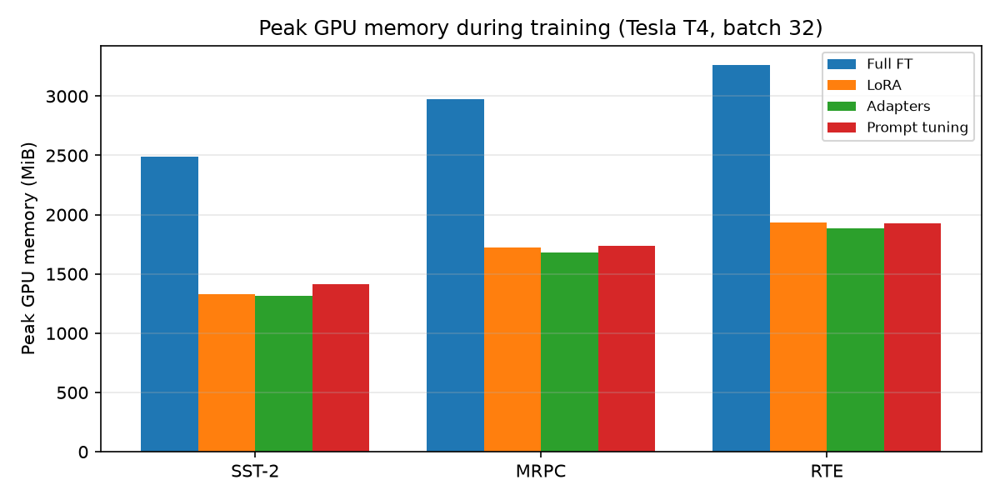
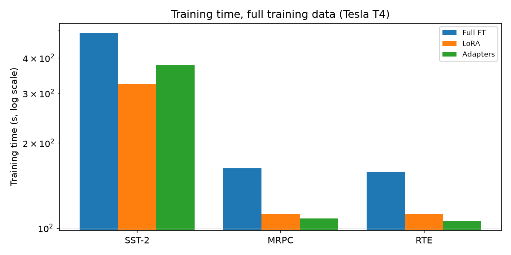
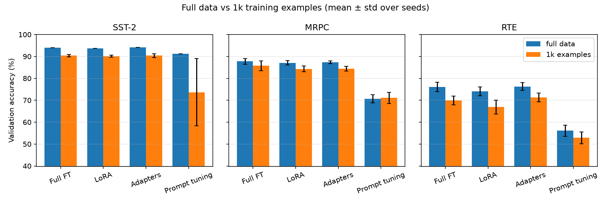
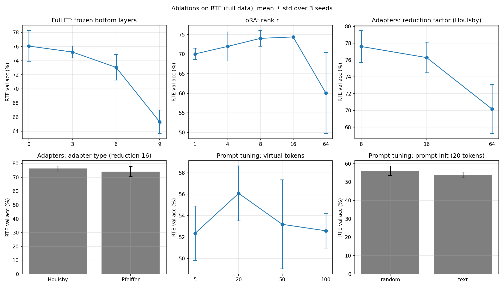

**Model:** `roberta-base` (124.6M parameters)
**Datasets:** GLUE SST-2, MRPC, RTE (Hugging Face `datasets`)
**Code and all result files:** <https://github.com/Anoop1230-tech/peft-showdown>

## Abstract

We compare four ways of adapting `roberta-base` to a classification task: full fine-tuning (Full FT), LoRA, bottleneck adapters and prompt tuning. Every method uses the same data splits, seeds, sequence length, batch size, epochs and GPU type (Tesla T4). We report accuracy (and F1 on MRPC), trainable parameters, peak GPU memory, training time and checkpoint size on three GLUE tasks, with the full training set and with only 1,000 training examples. The study has 122 training runs: 64 for the main grid, 16 for a learning-rate search and 42 for ablations.

The main findings are:

1. **Adapters and Full FT are tied on accuracy.** The differences between them (at most 0.4 points on full data) are smaller than the seed-to-seed standard deviation. Adapters train 1.9% of the parameters, use 42% less peak GPU memory and train 33% faster on RTE.
2. **LoRA is 0.3 to 2.1 points behind Full FT** while training 0.71% of the parameters, with a 3.4 MB checkpoint instead of 475.5 MB.
3. **In the 1k-example regime**, Full FT and adapters lose the least accuracy (3.9 points on average), LoRA loses 4.5, and prompt tuning becomes unstable (one SST-2 seed stays at 56% accuracy).
4. **Prompt tuning is weak at this model size.** On MRPC and RTE it scores close to always predicting the majority class (68.4% and 52.7%). None of the prompt lengths or initialisations we tried changed that, which is in line with Lester et al.'s result that prompt tuning only catches up with full fine-tuning at around 10B parameters.
5. **Ablations:** freezing the bottom layers of Full FT costs far more accuracy per saved parameter than LoRA or adapters. LoRA works best at rank 8 to 16. Adapters improve with a larger bottleneck (reduction factor 8: 77.6% on RTE).

## 1. Introduction

Full fine-tuning updates every weight of a pretrained model. For each new task this means storing another full copy of the model (about 500 MB for `roberta-base`) and keeping optimizer state for all 125M parameters in GPU memory during training. Parameter-efficient fine-tuning (PEFT) methods freeze the pretrained weights and train only a small number of new or selected parameters.

Published comparisons of PEFT methods often differ in base model, training budget or the way trainable parameters are counted (for example, whether the classification head is included). This project compares the methods under one fixed setup. The project brief asks for:

- a comparison of PEFT methods on accuracy, trainable parameters, memory and training time;
- GLUE SST-2, MRPC and RTE as datasets;
- full fine-tuning of BERT/RoBERTa, LoRA, adapters and prompt tuning, all with the same budget;
- one unified comparison table and the behaviour in a low-data regime (1k examples).

## 2. Background

**Adapters (Houlsby et al., 2019).** Small bottleneck MLPs are inserted into every transformer layer: a down-projection to dimension *m*, a nonlinearity, an up-projection back to the hidden size *d*, and a residual connection. The Houlsby variant places one adapter after the attention block and one after the feed-forward block. Houlsby et al. reached within 0.4% of full fine-tuning on GLUE with BERT-large while training about 3.6% of the parameters per task.

**LoRA (Hu et al., 2022).** For a frozen d×k weight matrix W₀, LoRA learns a low-rank update, so the layer computes W₀x + (α/r)·BAx, where B is d×r, A is r×k and the rank r is small. *B* starts at zero, so training starts from the pretrained model. After training, *BA* can be added into *W₀*, so inference is as fast as the original model. Hu et al. report that a rank as small as 1 to 8 on the query and value projections is often enough.

**Prompt tuning (Lester et al., 2021).** The model is frozen, and a sequence of *p* learnable "virtual token" embeddings is prepended to the input. Only these embeddings are trained. Lester et al. show with T5 that the gap to full fine-tuning is large for small models and closes only at around 10B parameters.

**Tooling.** LoRA and prompt tuning use the Hugging Face `peft` library (0.21.2). `peft` does not provide Houlsby-style bottleneck adapters, so adapters use AdapterHub's `adapters` library (1.3.0), which is built on the same `transformers` models. This is the one place where we could not use HF PEFT for every method, as the brief suggests.

## 3. Methods

All methods use `roberta-base` (12 layers, hidden size 768) with RoBERTa's standard classification head: a 768×768 dense layer with tanh, then a 768×2 projection, 592,130 parameters. The head is trained in every method and counted in every trainable-parameter number.

| Method | What is trained | Trainable params | % of model | Learning rate |
|---|---|---|---|---|
| Full FT | all weights + head | 124,647,170 | 100.00 | 2e-5 |
| LoRA | A, B on query and value of all 12 layers (r = 8, α = 16, dropout 0.1) + head | 887,042 | 0.71 | 5e-4 |
| Adapters | Houlsby `double_seq_bn`, reduction factor 16 (m = 48), 24 adapters + head | 2,381,186 | 1.87 | 3e-4 |
| Prompt tuning | 20 virtual tokens, random init (15,360 params) + head | 607,490 | 0.48 | 1e-2 |

The LoRA matrices add 294,912 parameters and the adapters add 1,789,056. With 0.6M parameters, the classification head is the largest trainable part for LoRA and prompt tuning.

## 4. Experimental setup

- **Same budget for every method:** AdamW, weight decay 0.01, linear warmup over 6% of the steps, batch size 32, maximum sequence length 128, fp16. Epochs: 3 for SST-2 full data, 10 for MRPC and RTE full data, 20 for every 1k run. Only the method-specific settings and the learning rate differ.
- **Splits:** GLUE test labels are hidden, so we report on the official GLUE validation split. We hold out 10% of the training set as our own dev split. The checkpoint with the best dev accuracy is kept (evaluated every epoch), and the LR search also uses the dev split. The validation split is never used for any choice.
- **Low-data regime:** 1,000 examples drawn from the training part with the run's seed. Every method sees the same 1,000 examples for a given seed.
- **Seeds:** 1, 2 and 3 for every configuration, except SST-2 full data (seed 1 only, about an hour per run for Full FT).
- **Measurements:** trainable parameters (`requires_grad`, head included), peak GPU memory (`torch.cuda.max_memory_allocated()` after resetting the peak counter before training), wall-clock time of `trainer.train()`, and the size of the saved trainable weights.
- **Hardware:** one Tesla T4 (16 GB) per run on Kaggle. Each run is a separate process. Every result file records its GPU, library versions and git commit.
- **Run count:** 4 methods × 16 runs = 64 main runs, 16 LR-search runs and 42 ablation runs, 122 in total. Every run writes one validated JSON file under `results/`.

### 4.1 Learning-rate search

The project plan asks for three learning rates per method, with seed 1, on RTE and MRPC full data, choosing on the dev split. The final runs used the learning rates recommended in the method papers. We then ran the search to check them. The rates in the final runs are marked with \*. Each cell shows dev accuracy, with GLUE validation accuracy in brackets.

| Method | LR | RTE dev (val) | MRPC dev (val) | Mean dev |
|---|---|---|---|---|
| Full FT | 1e-5 | 76.7 (76.2) | **88.3** (87.5) | 82.5 |
| Full FT | 2e-5\* | **78.3** (76.5) | 87.2 (87.5) | **82.8** |
| Full FT | 3e-5 | **78.3** (76.5) | 86.9 (89.7) | 82.6 |
| LoRA | 1e-4 | 70.7 (69.3) | 86.9 (85.3) | 78.8 |
| LoRA | 3e-4 | 74.7 (74.7) | **88.6** (86.5) | 81.7 |
| LoRA | 5e-4\* | **75.9** (76.2) | 88.3 (86.5) | **82.1** |
| Adapters | 1e-4 | 71.1 (68.2) | 86.9 (86.3) | 79.0 |
| Adapters | 3e-4\* | **77.9** (78.0) | 87.5 (87.0) | **82.7** |
| Adapters | 1e-3 | 75.9 (76.2) | **88.0** (90.0) | 82.0 |
| Prompt tuning | 1e-3 | 52.2 (56.0) | 69.2 (69.6) | 60.7 |
| Prompt tuning | 1e-2\* | **55.8** (55.6) | 72.8 (72.3) | **64.3** |
| Prompt tuning | 3e-2 | 52.2 (57.4) | **73.8** (69.6) | 63.0 |

For every method, the learning rate used in the final runs has the best mean dev accuracy, so the final runs did not need to be repeated. The differences between neighbouring rates are often within one seed's noise (Section 7).

## 5. Results

### 5.1 Unified comparison table

GLUE validation scores ×100, mean ± std over seeds 1–3 (SST-2 full: seed 1 only). Peak memory is the maximum over all of a method's runs. Times are on a Tesla T4.

| Method | SST-2 full | SST-2 1k | MRPC full acc | MRPC full F1 | MRPC 1k acc | MRPC 1k F1 | RTE full | RTE 1k |
|---|---|---|---|---|---|---|---|---|
| Full FT | 94.0 | 90.4 ± 0.5 | 87.7 ± 1.4 | 91.2 ± 1.2 | 85.8 ± 2.2 | 89.9 ± 1.4 | 76.1 ± 2.2 | 69.9 ± 2.1 |
| LoRA | 93.7 | 90.1 ± 0.5 | 87.1 ± 1.0 | 90.9 ± 0.6 | 84.3 ± 1.3 | 88.8 ± 0.9 | 74.0 ± 2.0 | 66.9 ± 3.2 |
| Adapters | 94.2 | 90.4 ± 0.8 | 87.3 ± 0.6 | 91.0 ± 0.4 | 84.4 ± 1.0 | 89.1 ± 0.8 | 76.3 ± 1.8 | 71.2 ± 2.0 |
| Prompt tuning | 91.2 | 73.7 ± 15.4 | 70.7 ± 1.9 | 81.5 ± 0.7 | 71.1 ± 2.5 | 81.9 ± 1.0 | 56.1 ± 2.6 | 52.8 ± 2.7 |
| *Majority class* | *50.9* | *50.9* | *68.4* | *81.2* | *68.4* | *81.2* | *52.7* | *52.7* |

| Method | Trainable params | % trainable | Peak mem (MiB) | Time RTE full (s) | Time SST-2 full (s) | Checkpoint (MB) |
|---|---|---|---|---|---|---|
| Full FT | 124,647,170 | 100.00 | 3,264 | 158 | 492 | 475.5 |
| LoRA | 887,042 | 0.71 | 1,937 | 112 | 324 | 3.4 |
| Adapters | 2,381,186 | 1.87 | 1,884 | 106 | 378 | 9.1 |
| Prompt tuning | 607,490 | 0.48 | 1,923 | 117 | 385 | 2.3 |

{width=85%}

{width=70%}

{width=70%}

**How close each PEFT method gets to Full FT.**

- **Adapters** are within ±0.4 points of Full FT on every full-data score: 94.2 vs 94.0 on SST-2, 87.3 vs 87.7 on MRPC and 76.3 vs 76.1 on RTE. All of these gaps are smaller than one standard deviation (1.4 to 2.2 points on MRPC and RTE), so the two methods are tied on accuracy. Adapters do this with 1.9% of the parameters, 42% less peak memory (1,884 vs 3,264 MiB) and 33% less training time on RTE (106 vs 158 s).
- **LoRA** is 0.3 points behind Full FT on SST-2, 0.6 on MRPC and 2.1 on RTE. It trains fewer parameters than adapters (0.89M vs 2.38M) and has a smaller checkpoint (3.4 vs 9.1 MB), but it is slightly less accurate on RTE.
- **Prompt tuning** is far behind on the two small tasks. On MRPC, 70.7% accuracy and 81.5 F1 are almost the same as always predicting "paraphrase" (68.4% / 81.2). On RTE, 56.1% is 3.4 points above the majority class (52.7%). On SST-2 with the full training set it reaches 91.2%, which shows that it can learn when it gets enough data and enough steps.

**Memory and time.** All three PEFT methods use about 40% less peak memory than Full FT, because the optimizer only stores state for the trainable parameters. The PEFT methods differ little from each other in memory (1,884–1,937 MiB), because the activations of the frozen 125M-parameter backbone dominate. Prompt tuning makes every input 20 tokens longer, so it is not faster than LoRA or adapters despite training the fewest parameters. On SST-2, LoRA was the fastest (324 s vs 492 s for Full FT).

### 5.2 Low-data regime (1,000 training examples)

Validation accuracy ×100, from full data to 1k examples (change in points), mean over seeds.

| Method | SST-2 | MRPC | RTE | Mean drop |
|---|---|---|---|---|
| Full FT | 94.0 → 90.4 (−3.7) | 87.7 → 85.8 (−2.0) | 76.1 → 69.9 (−6.1) | 3.9 |
| LoRA | 93.7 → 90.1 (−3.6) | 87.1 → 84.3 (−2.8) | 74.0 → 66.9 (−7.1) | 4.5 |
| Adapters | 94.2 → 90.4 (−3.8) | 87.3 → 84.4 (−2.9) | 76.3 → 71.2 (−5.1) | 3.9 |
| Prompt tuning | 91.2 → 73.7 (−17.5) | 70.7 → 71.1 (+0.4) | 56.1 → 52.8 (−3.2) | 6.8 |

{width=85%}

- **Full FT and adapters lose the least**, 3.9 points on average. Adapters have the best RTE 1k score (71.2 vs 69.9 for Full FT), but the two RTE 1k standard deviations (2.0 and 2.1) overlap, so we do not claim a clear winner.
- **LoRA loses a bit more**, mostly on RTE (−7.1). It also has the largest seed spread there (±3.2).
- **Prompt tuning becomes unstable.** On SST-2 1k, seeds 1 and 3 reach 83.7% and 81.3%, but seed 2 stays at 56.0%, close to chance, hence the ±15.4 standard deviation. The best checkpoints of the working seeds were at epochs 17 and 20 out of 20, so prompt tuning was still improving when training stopped. It needs more steps than the shared budget gives it. The small drops on MRPC and RTE do not mean prompt tuning holds up well with little data. On those tasks it was already near the majority-class baseline with full data, so it had little accuracy left to lose.

### 5.3 Ablations

Each ablation changes one setting of one method. All runs are on RTE with the full training data and seeds 1–3. The default row of each method is the final run from Section 5.1. LoRA keeps α = 2r, so the scale α/r stays at 2 for every rank. All other settings, including the learning rate, are unchanged.

| Method | Setting | RTE val acc | Trainable params | Peak mem (MiB) | Time (s) |
|---|---|---|---|---|---|
| Full FT | 0 frozen layers (default) | 76.1 ± 2.2 | 124,647,170 | 3,264 | 158 |
| Full FT | bottom 3 layers + embeddings frozen | 75.2 ± 0.8 | 64,382,978 | 2,349 | 116 |
| Full FT | bottom 6 layers + embeddings frozen | 73.0 ± 1.8 | 43,119,362 | 1,754 | 95 |
| Full FT | bottom 9 layers + embeddings frozen | 65.3 ± 1.7 | 21,855,746 | 1,158 | 73 |
| LoRA | r = 1 | 70.0 ± 1.4 | 628,994 | 1,932 | 109 |
| LoRA | r = 4 | 72.0 ± 3.7 | 739,586 | 1,934 | 110 |
| LoRA | r = 8 (default) | 74.0 ± 2.0 | 887,042 | 1,937 | 112 |
| LoRA | r = 16 | 74.4 ± 0.0 | 1,181,954 | 1,943 | 110 |
| LoRA | r = 64 | 60.0 ± 10.3 | 2,951,426 | 1,975 | 110 |
| Adapters | Houlsby, reduction 8 (m = 96) | 77.6 ± 1.9 | 4,151,810 | 1,926 | 107 |
| Adapters | Houlsby, reduction 16 (default) | 76.3 ± 1.8 | 2,381,186 | 1,884 | 106 |
| Adapters | Houlsby, reduction 64 (m = 12) | 70.2 ± 2.9 | 1,053,218 | 1,853 | 105 |
| Adapters | Pfeiffer (`seq_bn`), reduction 16 | 74.1 ± 3.6 | 1,486,658 | 1,880 | 104 |
| Prompt tuning | 5 virtual tokens | 52.3 ± 2.5 | 595,970 | 1,796 | 105 |
| Prompt tuning | 20 virtual tokens, random init (default) | 56.1 ± 2.6 | 607,490 | 1,923 | 117 |
| Prompt tuning | 50 virtual tokens | 53.2 ± 4.2 | 630,530 | 2,180 | 135 |
| Prompt tuning | 100 virtual tokens | 52.6 ± 1.6 | 668,930 | 2,626 | 175 |
| Prompt tuning | 20 virtual tokens, text init | 53.8 ± 1.6 | 607,490 | 1,923 | 111 |

{width=100%}

- **Partial Full FT is a poor alternative to PEFT.** Freezing the bottom 9 layers still trains 21.9M parameters but drops RTE accuracy to 65.3%. LoRA trains 25 times fewer parameters (0.89M) and reaches 74.0%. Freezing 3 layers keeps most of the accuracy (75.2%) with 28% less memory than Full FT, but it still uses more memory than any PEFT method.
- **LoRA rank:** accuracy rises from r = 1 (70.0) to r = 8–16 (74.0–74.4) and then collapses at r = 64. At r = 64, seeds 1 and 2 stayed at 52.7% and 55.6% (majority-class level), while seed 3 reached 71.8%. With α = 2r and the same learning rate, larger ranks give larger updates early in training, and 5e-4 appears to be too high for r = 64. We did not re-tune the learning rate per rank, so this shows instability at a fixed learning rate. It does not show that high rank is worse in general. The r = 16 runs all reached the same validation accuracy (74.37%), even though their dev accuracies differed (71.9–82.3%).
- **Adapter size and type:** a larger bottleneck helps on RTE. Reduction factor 8 reaches 77.6%, the best RTE score in the study, with 4.2M trainable parameters (3.3%) and almost no extra memory. Reduction factor 64 loses 6 points. With the same reduction factor, the Pfeiffer configuration (one adapter per layer, after the feed-forward block) is 2.2 points below Houlsby, with 38% fewer trainable parameters and a larger seed spread.
- **Prompt length and initialisation:** no setting moves prompt tuning more than 3.4 points above the majority class (52.7%). Longer prompts make every input longer, so memory and time grow with prompt length (100 tokens: 2,626 MiB and 175 s, more than LoRA or adapters) without any gain in accuracy. Initialising the prompt from the embeddings of a short text did not help either (53.8 vs 56.1).

## 6. Discussion

**Why prompt tuning is weak on `roberta-base`.** Prompt tuning trains only 15,360 prompt parameters and can change the model's behaviour only through the attention to those 20 positions. Lester et al. found that this indirect control works only when the frozen model is very large: for T5, prompt tuning matched full fine-tuning on SuperGLUE only at about 11B parameters and was far behind for models under 1B. `roberta-base` has 125M parameters, so our results agree with that finding. Our ablations show that the problem is not the prompt length or the initialisation. Prompt tuning did learn SST-2 with the full 67k examples (91.2%). Two tasks, sentence-pair inference with 2.5k examples (RTE) and paraphrase detection with 3.7k examples (MRPC), are too hard for it at this scale and budget.

**Why adapters can match Full FT with 2% of the parameters.** RTE and MRPC have only a few thousand training examples, and Full FT overfits easily on them (RTE dev accuracy varies by ±4.4 points across seeds). Adapters keep the pretrained weights fixed and add a small, zero-centred change to each layer, which limits how far the model can move from its pretrained state. The ablations show that this capacity matters: more adapter capacity (reduction 8) helped, and less (reduction 64) hurt.

**Recommendations.**

| Situation | Recommendation | Evidence from our runs |
|---|---|---|
| Limited GPU memory | Adapters or LoRA | about 1.9 GB peak vs 3.3 GB for Full FT, with ≤ 2.1 points accuracy loss |
| Limited training time | LoRA on large data, adapters on small data | SST-2: 324 s (LoRA) vs 492 s; RTE: 106 s (adapters) vs 158 s |
| Very little data (1k) | Adapters or Full FT | smallest mean drop (3.9 points); avoid prompt tuning (unstable) |
| Many tasks on one server | LoRA | 3.4 MB per task, and the update can be merged into the weights, so no extra inference cost |
| Highest accuracy | Adapters (reduction 8) or Full FT | 77.6 vs 76.1 on RTE; differences are within noise |

## 7. Limitations

- **SST-2 full data has only one seed per method** (an hour per Full FT run on a T4). The SST-2 full numbers have no standard deviation, and the differences between methods there (≤ 3 points, ≤ 0.5 among Full FT, LoRA and adapters) should not be read as a ranking.
- **Three seeds are few for RTE and MRPC.** Many of our differences (Full FT vs adapters, LoRA rank 8 vs 16, adapter reduction 8 vs 16) are smaller than one standard deviation.
- **The LR search was done after the final runs**, with seed 1 only, and it confirmed the learning rates the final runs had used. Several neighbouring rates differ by less than one point of dev accuracy, which is within seed noise.
- **Ablations are on RTE full data only**, and the learning rate was not re-tuned for each setting. This matters most for LoRA r = 64.
- **The same epoch budget does not mean the same convergence.** Prompt tuning's best checkpoints were often in the last epochs, so it might do better with more steps. We kept the shared budget because the brief asks for the same budget for every method.
- **The dev split changes with the seed** (the 10% split is drawn with the run's seed), so dev accuracy varies more across seeds than validation accuracy does.
- **Peak memory** is `max_memory_allocated`, which leaves out the allocator cache and CUDA context, so `nvidia-smi` would show higher numbers. Times are wall-clock on shared Kaggle T4 machines and can vary by a few percent.
- **Adapters use AdapterHub instead of HF PEFT**, because PEFT has no Houlsby adapters. The model wrapper differs, but the backbone, head size and training loop are the same.
- **We report on the GLUE validation split**, because GLUE test labels are hidden. The validation split was never used for model or LR selection.

## 8. Conclusion

With one shared budget on `roberta-base`, adapters and LoRA keep almost all of Full FT's accuracy on SST-2, MRPC and RTE. They train 0.7–1.9% of the parameters, use about 40% less GPU memory and store each task in 3–9 MB instead of 475 MB. Adapters are tied with Full FT, and LoRA is 0.3–2.1 points behind. With 1,000 training examples, Full FT and adapters lose the least accuracy. Prompt tuning has the smallest checkpoint, but at this model size it stays near the majority-class baseline on MRPC and RTE and is unstable with little data, as Lester et al.'s scaling results predict. The ablations show that adapter and LoRA capacity matter up to a point, and that freezing layers of Full FT is a much worse trade-off than either PEFT method.

## Team contributions

| Member | Method | Shared work |
|---|---|---|
| Deepak Mandal | Full fine-tuning (16 runs) | repo, data pipeline, training script, Kaggle run scripts |
| Anoop Kumar | LoRA (16 runs) | results format and validation, analysis notebook, LR search and all ablation runs (`scripts/run_extra.sh`, `analysis/extra_analysis.py`) |
| Chiranjeet Biswas | Adapters (16 runs) | background and literature, report |
| Byagari Praveen Kumar | Prompt tuning (16 runs) | results tables, plots, slides |

## References

1. E. J. Hu, Y. Shen, P. Wallis, Z. Allen-Zhu, Y. Li, S. Wang, L. Wang, W. Chen. *LoRA: Low-Rank Adaptation of Large Language Models.* ICLR 2022. <https://arxiv.org/abs/2106.09685>
2. N. Houlsby, A. Giurgiu, S. Jastrzebski, B. Morrone, Q. de Laroussilhe, A. Gesmundo, M. Attariyan, S. Gelly. *Parameter-Efficient Transfer Learning for NLP.* ICML 2019. <https://arxiv.org/abs/1902.00751>
3. B. Lester, R. Al-Rfou, N. Constant. *The Power of Scale for Parameter-Efficient Prompt Tuning.* EMNLP 2021. <https://arxiv.org/abs/2104.08691>
4. J. Pfeiffer, A. Kamath, A. Rücklé, K. Cho, I. Gurevych. *AdapterFusion: Non-Destructive Task Composition for Transfer Learning.* EACL 2021. <https://arxiv.org/abs/2005.00247>
5. A. Wang, A. Singh, J. Michael, F. Hill, O. Levy, S. Bowman. *GLUE: A Multi-Task Benchmark and Analysis Platform for Natural Language Understanding.* ICLR 2019. <https://arxiv.org/abs/1804.07461>
6. Y. Liu et al. *RoBERTa: A Robustly Optimized BERT Pretraining Approach.* 2019. <https://arxiv.org/abs/1907.11692>
