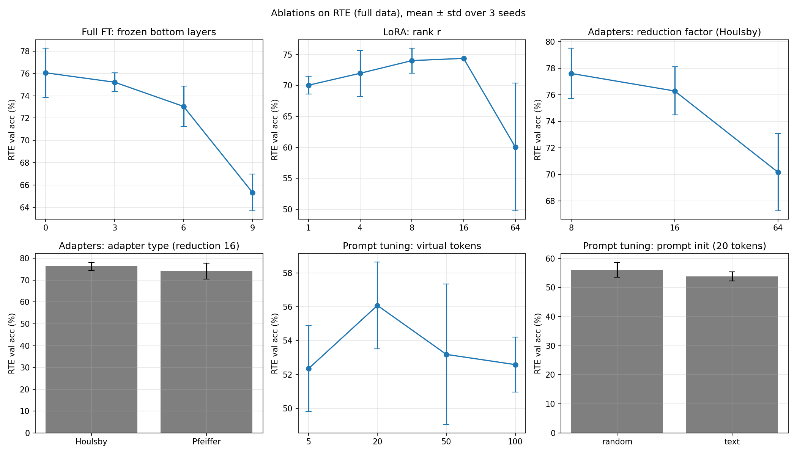

# Parameter-Efficient Fine-Tuning Showdown
## Full Fine-Tuning vs LoRA vs Adapters vs Prompt Tuning

**Team 18:**
- **Deepak Mandal**: Full fine-tuning, shared pipeline
- **Anoop Kumar**: LoRA, results tracking, LR search and ablations
- **Chiranjeet Biswas**: Adapters, literature review
- **Byagari Praveen Kumar**: Prompt tuning, analysis and plots

**Model:** `roberta-base` (124.6M params) · **Tasks:** GLUE SST-2, MRPC, RTE
**Repository:** github.com/Anoop1230-tech/peft-showdown

---

# Problem

* Full fine-tuning updates all 125M weights:
  * one ~475 MB checkpoint per task
  * optimizer state for every weight in GPU memory
* PEFT methods freeze the model and train a small set of parameters.
* **Question:** under one fixed budget, how do they compare on accuracy, trainable params, memory and time, with full data and with only 1,000 examples?

---

# The four methods

| Method | What is trained | Trainable params | % | Checkpoint |
|---|---|---|---|---|
| Full FT | all weights | 124,647,170 | 100.00 | 475.5 MB |
| LoRA (Hu et al., 2022) | ΔW = BA on query/value, r = 8 | 887,042 | 0.71 | 3.4 MB |
| Adapters (Houlsby et al., 2019) | 2 bottleneck MLPs per layer, m = 48 | 2,381,186 | 1.87 | 9.1 MB |
| Prompt tuning (Lester et al., 2021) | 20 virtual tokens | 607,490 | 0.48 | 2.3 MB |

The classification head (592,130 params) is trained and counted for every method.

---

# Setup: same budget for every method

* AdamW, wd 0.01, warmup 6%, batch 32, max length 128, fp16, one Tesla T4
* Epochs: SST-2 full 3, MRPC/RTE full 10, every 1k run 20
* Model selection on our 10% dev split; scores on GLUE validation
* Seeds 1, 2, 3 (SST-2 full: seed 1)
* **122 runs:** 64 main + 16 LR search + 42 ablations
* LR search (3 LRs per method, RTE + MRPC): the LR used for each method's final runs had the best mean dev accuracy

---

# Unified comparison table

GLUE validation ×100, mean ± std over 3 seeds (SST-2 full: 1 seed).

| Method | SST-2 full | SST-2 1k | MRPC full acc / F1 | RTE full | RTE 1k | Mem (MiB) | Time RTE (s) |
|---|---|---|---|---|---|---|---|
| Full FT | 94.0 | 90.4 ± 0.5 | 87.7 ± 1.4 / 91.2 | 76.1 ± 2.2 | 69.9 ± 2.1 | 3,264 | 158 |
| LoRA | 93.7 | 90.1 ± 0.5 | 87.1 ± 1.0 / 90.9 | 74.0 ± 2.0 | 66.9 ± 3.2 | 1,937 | 112 |
| Adapters | 94.2 | 90.4 ± 0.8 | 87.3 ± 0.6 / 91.0 | 76.3 ± 1.8 | 71.2 ± 2.0 | 1,884 | 106 |
| Prompt tuning | 91.2 | 73.7 ± 15.4 | 70.7 ± 1.9 / 81.5 | 56.1 ± 2.6 | 52.8 ± 2.7 | 1,923 | 117 |
| Majority class | 50.9 | 50.9 | 68.4 / 81.2 | 52.7 | 52.7 | | |

---

# Finding 1: Adapters are tied with Full FT

* Within ±0.4 points of Full FT on every full-data score; all gaps are smaller than one std
* 1.9% of the parameters, **42% less peak memory**, **33% faster** on RTE
* 9.1 MB checkpoint instead of 475.5 MB

# Finding 2: LoRA is close behind

* 0.3 (SST-2), 0.6 (MRPC) and 2.1 (RTE) points behind Full FT
* 0.71% of the parameters, 3.4 MB checkpoint
* Fastest on SST-2 (324 s vs 492 s); the update can be merged into the weights, so no extra inference cost

---

# Finding 3: Low-data regime (1k examples)

| Method | SST-2 | MRPC | RTE | Mean drop |
|---|---|---|---|---|
| Full FT | −3.7 | −2.0 | −6.1 | 3.9 |
| LoRA | −3.6 | −2.8 | −7.1 | 4.5 |
| Adapters | −3.8 | −2.9 | −5.1 | 3.9 |
| Prompt tuning | −17.5 | +0.4 | −3.2 | 6.8 |

* Full FT and adapters lose the least; adapters have the best RTE 1k score (71.2), within noise of Full FT
* Prompt tuning is unstable: SST-2 1k seed 2 stays at 56%, while the other seeds were still improving at epoch 17–20

---

# Finding 4: Prompt tuning is weak at 125M params

* MRPC 70.7 / RTE 56.1: close to always predicting the majority class (68.4 / 52.7)
* It does learn SST-2 with 67k examples (91.2)
* No prompt length (5 / 20 / 50 / 100) or text initialisation fixes it
* Matches Lester et al.: prompt tuning only catches up with full fine-tuning at around 10B parameters

---

# Ablations (RTE full data, 3 seeds)

---

# What the ablations show

* **Freezing layers of Full FT** is a bad trade-off: 9 frozen layers still train 21.9M params and reach only 65.3 (LoRA: 0.89M params, 74.0)
* **LoRA rank:** best at r = 8–16 (74.0–74.4); r = 64 is unstable at the same LR (2 of 3 seeds stuck at majority class)
* **Adapter size:** reduction 8 gives **77.6**, the best RTE score in the study; reduction 64 drops to 70.2; Pfeiffer (one adapter per layer) is 2.2 points below Houlsby
* **Prompt tuning:** longer prompts cost memory and time (100 tokens: 2,626 MiB, 175 s) without any gain in accuracy

---

# Which method to choose?

| Situation | Choice | Why |
|---|---|---|
| Limited GPU memory | Adapters or LoRA | ~1.9 GB vs 3.3 GB, ≤ 2.1 points lost |
| Limited time | LoRA (large data), adapters (small data) | 324 s vs 492 s on SST-2; 106 s vs 158 s on RTE |
| Very little data | Adapters or Full FT | smallest drop at 1k; avoid prompt tuning |
| Many tasks on one server | LoRA | 3.4 MB per task, no inference cost |

---

# Limitations

* SST-2 full: 1 seed per method; 3 seeds is few for RTE/MRPC, and many gaps are within one std
* LR search was run after the final runs (seed 1) and confirmed their LRs
* Ablations only on RTE, LR not re-tuned per setting (matters for LoRA r = 64)
* Same epochs for everyone; prompt tuning may need more steps
* Adapters use AdapterHub, since HF PEFT has no Houlsby adapters

---

# Conclusion

* Adapters and LoRA keep almost all of Full FT's accuracy with 0.7–1.9% of the parameters, ~40% less memory and 3–9 MB per task
* With 1k examples, Full FT and adapters lose the least
* Prompt tuning has the smallest checkpoint but does not work well at this model size

**All 122 runs, tables, plots, report and code:** github.com/Anoop1230-tech/peft-showdown
